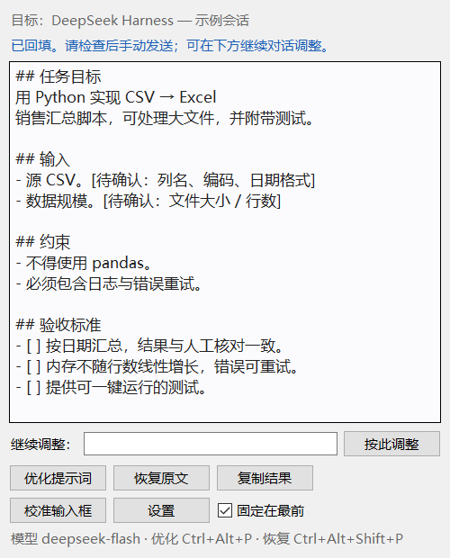

# PromptPolish

> 为 **DeepSeek Harness** 打造的 Windows 桌面悬浮提示词优化器。
> 写好草稿 → 按一次快捷键 → 模型重写并安全回填 → 你检查后手动发送。




PromptPolish 会读取 DeepSeek Harness 当前输入框里的**纯文本草稿**，调用 DeepSeek 官方 API
把它重写成结构清晰、可执行的提示词，并在确认聊天、焦点、草稿都没有变化后回填到输入框。
它**不会自动发送**，原文会保留，可随时恢复。

> 这是个人开源项目，不是 DeepSeek 官方产品。当前只对 DeepSeek Harness 桌面版做过完整实测；
> 没有验证过名为 “Codex” 的桌面应用。
>
> **原生插件版（推荐）**：`dsh-plugin-prompt-polish/` 把优化做成模型选择器左侧的图标按钮，
> 直接使用当前会话的 DSH 模型与额度，不需要 API Key、不弹外部窗口。
> 安装与限制见 [插件 README](dsh-plugin-prompt-polish/README.md)；
> 市场已收录：[awesome-dsh-plugin 条目](https://github.com/awesome-dsh-plugin/awesome-dsh-plugin/blob/main/data/plugins/CAI-KUN-MAX__prompt-polish--dsh-plugin-prompt-polish.yml)。

## 两种形态

- **DSH 原生插件（推荐）**：模型选择器左侧的 ✨ 图标，直接使用当前会话的 DSH 模型与额度，
  不需要 API Key，不弹外部窗口。已收录到 DSH 插件市场，搜索 `PromptPolish` 安装；
  源码与说明见 [插件 README](dsh-plugin-prompt-polish/README.md)。
- **独立悬浮窗**：本 README 其余部分介绍的 Python 工具，适合不安装插件、或需要
  多轮对话调整与「固定在最前」的场景。

---

## 功能

- **一键优化**：默认 `Ctrl+Alt+P`，不需要复制粘贴到网页。
- **多轮调整**：回填后可在悬浮窗输入“再精简 30%”“补充验收标准”，继续对话并重新回填。
- **固定在最前**：勾选后窗口始终置顶，滚动 DeepSeek Harness 页面也不会被盖住。
- **安全回填**：校验窗口句柄、聊天标题、输入框焦点、草稿内容；任何一项变化就停止。
- **特殊内容拦截**：附件、图片、@ 提及弹窗、`/` 指令、技能/文件引用会被拒绝。
- **失败保护**：未配置密钥、401/402/429、网络错误、超时、空回复时原文不动。
- **恢复原文**：`Ctrl+Alt+Shift+P` 或按钮一键恢复；若草稿已被手动修改，则拒绝覆盖。
- **纯标准库**：Python + Windows 自带 PowerShell，无第三方 Python 依赖。

## 环境要求

- Windows 10/11（实测 Windows 11，1920×1080，125% 缩放）
- Python 3.10+，包含 tkinter（python.org 安装包默认包含）
- Windows PowerShell 5.1（系统自带）
- 已安装 DeepSeek Harness 桌面版
- DeepSeek API Key（[platform.deepseek.com](https://platform.deepseek.com/api_keys)）

## 快速开始

### 1. 获取代码

```powershell
git clone https://github.com/CAI-KUN-MAX/prompt-polish.git
cd prompt-polish
```

也可以直接下载 ZIP 解压。**不要只复制 `prompt_polish.pyw`**，它依赖 `prompt_polish\` 目录。

### 2. 创建快捷方式

```powershell
powershell -ExecutionPolicy Bypass -File .\install.ps1
```

会在桌面创建 `PromptPolish.lnk`，不需要管理员权限。也可以直接双击 `启动 PromptPolish.vbs`。

### 3. 配置 API Key

不要把密钥写进代码、配置文件或聊天里。任选一种：

**方式 A：用户环境变量（推荐）**

```powershell
setx DEEPSEEK_API_KEY "sk-..."
```

然后重新启动 PromptPolish（新进程才能读到）。

**方式 B：工具内写入**

打开 PromptPolish → **设置 → 写入 API Key**。密钥保存在：

```text
%APPDATA%\PromptPolish\api_key.txt
```

该目录默认仅当前用户可访问；写入后会立即验证能否读回。

**方式 C：自定义密钥文件**

```powershell
setx PROMPTPOLISH_KEY_FILE "D:\path\to\key.txt"
```

### 4. 校准输入框

首次启动后点 **「校准输入框」**，确定后 5 秒内把鼠标移到 DeepSeek Harness 的输入框文字区域并停住。
工具只记录鼠标相对窗口的位置，不读取内容。

- 默认位置是窗口宽 53%、高 78%，通常就是输入框文字行。
- 如果点在底部工具栏，会被拒绝保存；旧配置里的危险值会自动回落到 0.78。
- 窗口移动、缩放或 DSH 改版后，重新校准。

## 使用

| 动作 | 默认快捷键 |
| --- | --- |
| 优化当前草稿 | `Ctrl+Alt+P` |
| 恢复原文 | `Ctrl+Alt+Shift+P` |

1. 在 DeepSeek Harness 输入框写好提示词。
2. 按 `Ctrl+Alt+P` 或点 **优化提示词**。
3. 等待状态显示“已回填”，检查后**手动发送**。
4. 不满意可在 **继续调整** 输入要求，例如：
   - `再精简 30%，保留约束和验收标准`
   - `补充异常处理和验收标准，不要新增事实`
   - `把输入输出改成表格`
5. 想完全回到最初：按恢复快捷键，或点 **恢复原文**。

### 固定在最前

主界面勾选 **「固定在最前」**，窗口会设置 Windows `WS_EX_TOPMOST` 置顶样式；
滚动 DSH 页面或切换窗口时仍停留在最上方。取消勾选恢复普通窗口行为。
状态会保存到配置。优化/回填期间会临时取消置顶，结束后自动恢复。

### 回填的安全规则

写入前依次确认：

1. 目标窗口句柄仍存在；
2. 窗口标题（聊天名）与优化开始时一致；
3. 点击后聊天没有变化；
4. UIA 能找到输入框，且焦点确实在该输入框；
5. 输入区没有附件/引用节点；
6. 当前草稿与优化开始时逐字一致；
7. 写入后重新读取，内容必须一致，否则尝试恢复原文。

任何一项不满足：**不写入**，优化结果留在悬浮窗里，可复制。
工具只使用 `Ctrl+A` / `Ctrl+V`，不会按 Enter，也不会点发送按钮。

## 模型与费用

默认使用 DeepSeek 官方 OpenAI 兼容接口：`https://api.deepseek.com/chat/completions`。

| 模型 | 说明 |
| --- | --- |
| `deepseek-flash` | 默认，速度快、费用低，结构化重写足够 |
| `deepseek-v4-pro` | 质量优先，拆解更细，但明显更慢、费用更高 |
| `deepseek-chat` | 兼容旧配置的别名，新版本默认不再使用 |

在 **设置 → 模型** 中切换。费用按 token 计费，以
[官方定价](https://api-docs.deepseek.com/quick_start/pricing) 为准；
一次优化通常是几百到几千 token。工具不会自动重试，避免重复计费。

> 网页版 DeepSeek 免费，单次质量也可能更好；本工具的价值在于**就地完成、多轮调整、安全回填**。
> 如果只是偶尔精修，网页版更划算。

## 配置

配置文件：`%APPDATA%\PromptPolish\config.json`（不会保存密钥）。

| 字段 | 默认值 | 说明 |
| --- | --- | --- |
| `model` | `deepseek-flash` | 模型名 |
| `api_base_url` | `https://api.deepseek.com` | OpenAI 兼容地址 |
| `temperature` | `0.4` | 采样温度 |
| `timeout_seconds` | `60` | 请求超时 |
| `max_input_chars` | `12000` | 草稿字符上限 |
| `hotkey` | `Ctrl+Alt+P` | 优化快捷键 |
| `hotkey_restore` | `Ctrl+Alt+Shift+P` | 恢复快捷键 |
| `window_title_regex` | `DeepSeek Harness\|Codex` | 目标窗口标题正则 |
| `composer_name_prefix` | `发消息或创建任务` | 输入框名称前缀 |
| `click_rel_x` / `click_rel_y` | `0.53` / `0.78` | 校准点（相对窗口） |
| `always_on_top` | `true` | 是否固定在最前 |
| `debug_log` | `false` | 是否写调试日志（不含草稿） |

环境变量 `PROMPTPOLISH_CONFIG` 可覆盖配置文件路径（便于测试）。

## 工作原理

```text
┌────────────────────┐      ┌──────────────────────┐
│ PromptPolish (Tk)  │      │ DeepSeek Harness     │
│ 悬浮窗 / 全局快捷键 │      │ Electron + Chromium  │
└─────────┬──────────┘      └──────────┬───────────┘
          │                            │
          │ 1. 点击输入框，激活无障碍树 │
          │ 2. UIA 读取草稿 / 校验焦点 ├──────────►
          │ 3. 调用 DeepSeek API        │
          │ 4. 比对标题与草稿           │
          │ 5. Ctrl+A / Ctrl+V 回填     ├──────────►
          │ 6. 重新读取并校验           │
          └────────────────────────────┘
```

- `prompt_polish/uia_bridge.ps1`：PowerShell + UI Automation，负责定位输入框、焦点校验、
  读取 `ValuePattern`、粘贴回填、失败回滚。
- `prompt_polish/llm.py`：DeepSeek OpenAI 兼容客户端，支持多轮对话。
- `prompt_polish/app.py`：Tk 悬浮窗、快捷键、状态机、回填安全校验。

为什么不用浏览器调试接口或 DSH 插件：DSH 桌面端没有开放 DevTools 端口，
单实例锁导致无法挂到现有窗口；内部 Web 服务需要登录 token，草稿又是客户端状态。
因此选择了 Windows 官方无障碍接口，并接受它的局限（见下）。

## 测试

```powershell
# 25 个单元测试：规则、快捷键、配置迁移、多轮对话、API 错误映射
python -m unittest discover -s tests -t . -v

# 7 个真实 GUI 场景：优化、继续调整、恢复、草稿变化、模型失败、附件、无密钥
python tests/e2e_gui.py

# 「固定在最前」按钮实测：点击、持久化、busy 恢复、DSH 滚动
python tests/e2e_pin.py
```

端到端脚本使用本地 mock 模型，不产生真实 API 费用；会临时改写当前 DSH 草稿并在结束后清空。
真实 API 也用有效密钥跑通过：一次优化 905 字符，追加“再精简 30%”后 692 字符。

## 已知限制

1. **UI 自动化不是官方 API**。DSH 升级后输入框名称、CSS 类名（`*_card`、`*_add`、`*_input`）
   或布局可能变化，工具会以“无法定位/无法确认焦点”安全失败，不会乱写。
2. 需要一次点击激活 Chromium 无障碍树；点击坐标来自校准，点偏会安全停止。
3. 只支持纯文字；附件、图片、@ 提及、`/` 指令、技能/文件引用会被拒绝。
   检测是 UIA 节点 + 文本规则的保守启发式，可能误报。
4. 聊天身份依赖窗口标题 + 窗口句柄；DSH 窗口标题就是当前聊天名。
5. 剪贴板会保存/恢复文本，图片等非文本格式可能丢失。
6. 恢复仅限本次运行内存；关闭工具后不能“一键恢复”。
7. 未验证 Codex 桌面应用；`window_title_regex` 可配置，但定位逻辑未针对它测试。
8. 多显示器、不同 DPI、Windows 10 未实测。
9. 不读取聊天历史，不做上下文总结，只处理当前输入框。

## 隐私与安全

- 只读取输入框当前的 `ValuePattern` 文本，不遍历聊天记录、不读项目文件。
- 密钥不写入 `config.json`、不写日志、不出现在错误信息里。
- 调试日志只有步骤、长度和错误码，不包含草稿正文或密钥。
- 原文和优化结果仅保存在内存；回填后恢复文本剪贴板。
- 不自动发送消息，不按 Enter。

## 故障排查

| 现象 | 处理 |
| --- | --- |
| 未找到 DeepSeek Harness 窗口 | 先打开 DSH 聊天窗口；或设置里改 `window_title_regex` |
| 无法定位输入框 | 重新校准；确认 DSH 没有改版；点输入框文字行 |
| 无法确认焦点 | 校准点可能落在输入框外；重新校准 |
| 校准点被拒绝 | 不要点底部工具栏（Y 应在 0.50–0.84） |
| 快捷键无反应 | 组合被占用；设置里换一个 |
| 密钥文件存在但无法读取 | `icacls "$env:APPDATA\PromptPolish\api_key.txt" /reset`，或重新写入 |
| 401/403 | 密钥错误或失效，重新生成 |
| 402 | 账户余额不足 |
| 429 | 频率/额度受限，稍后重试 |
| 超时/网络错误 | 检查网络/代理；增大超时；原文不会变 |
| 优化效果不明显 | 模型换 `deepseek-v4-pro`；在继续调整里明确“结构重写、补充验收标准” |
| 继续调整提示草稿已修改 | 重新点“优化提示词”开始新一轮 |

## 项目结构

```text
prompt_polish.pyw              启动入口
prompt_polish/
  app.py                       悬浮窗、快捷键、状态机、多轮调整
  config.py                    配置、密钥、快捷键、v1→v2 迁移
  dsh.py                       UIA 桥客户端与错误码映射
  uia_bridge.ps1               PowerShell UIA 自动化（纯 ASCII）
  llm.py                       DeepSeek OpenAI 兼容客户端
  rules.py                     文本规则与特殊内容检测
  winapi.py                    Win32 窗口、DPI、全局热键
tests/
  mock_llm.py                  本地 mock 模型
  test_core.py                 25 个单元测试
  e2e_gui.py                   7 个真实 GUI 场景
  e2e_pin.py                   固定按钮实测
install.ps1                    创建桌面快捷方式
install-dsh-plugin.ps1         安装 DSH 原生插件（需重启 DSH）
dsh-plugin-prompt-polish/      DSH 插件：host 路由 + composer 图标
config.example.json            配置示例
docs/screenshot.png            README 截图
```

## License

[MIT](LICENSE) © 2026 CAI-KUN-MAX
