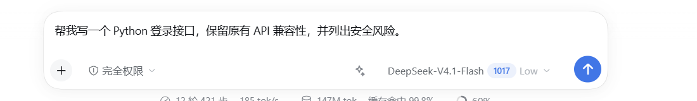
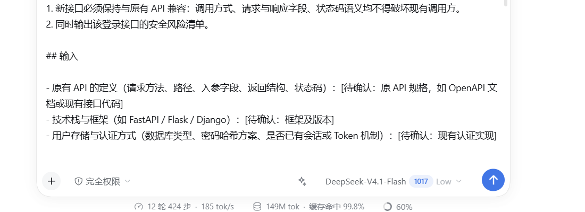

# dsh-plugin-prompt-polish

[](https://github.com/awesome-dsh-plugin/awesome-dsh-plugin/blob/main/data/plugins/CAI-KUN-MAX__prompt-polish--dsh-plugin-prompt-polish.yml)
[](https://www.npmjs.com/package/dsh-plugin-prompt-polish)

DeepSeek Harness 的**原生插件版**提示词优化器：模型选择器左侧一个小图标，点一下优化当前输入框草稿。
不弹外部窗口、不复制粘贴、不需要 API Key —— 直接使用当前会话的 DSH 模型和额度。

```
[ + ]  [完全权限]  [✨]  [DeepSeek-V4.1-Flash ▾]  [发送]
                    ↑
              提示词优化按钮
```





## 功能

- **图标按钮**：注册在 composer 的 `conversation.input.right` 插槽，位于模型选择器左侧；只有图标，无文字。
- **使用 DSH 额度**：服务端通过 `ctx.llm.stream()` 调用当前会话的 provider/model，凭据由 DSH 的 credentials seam 解析。
- **原地回填**：通过 composer 的 `inputActions.setDraft()` 写回，不发送消息，不新增会话轮次。
- **草稿变化保护**：请求返回时如果草稿已变化，拒绝回填并在按钮上显示红色错误态。
- **引用/附件保护**：草稿含引用 chip 或图片附件时拒绝优化。
- **Shift+点击恢复**：优化成功后再按住 Shift 点图标，可恢复上一版原文。
- **错误提示**：空草稿、插件未加载、网络错误、模型失败会在按钮 `title` 与红色状态中显示。

## 已验证（本机真实运行）

- `/prompt-polish/health` 返回 200，插件 host 半已加载。
- 模型选择器左侧出现 ✨ 图标，位置与截图一致。
- 真实鼠标点击：79 字草稿 → 15 秒后回填为 1415 字结构化提示词。
- 再次点击：1415 字 → 1511 字，确认可以对当前结果继续优化。
- 全程未按 Enter、未点发送，草稿留在输入框中。
- 客户端使用 `sessionId` 前缀 `session-`，与 host 的 `ctx.sessions.get()` 对齐。

> Shift+点击恢复原文已实现，但本次自动化仅验证了普通点击；真实 Shift+点击请在界面中试一次。

## 安装

需要 DSH 桌面版和 Node.js（用于安装时的导入自检）。

### 从 DSH 插件市场

已收录到 DSH 插件市场（PR #14055 已合并）：

<https://github.com/awesome-dsh-plugin/awesome-dsh-plugin/blob/main/data/plugins/CAI-KUN-MAX__prompt-polish--dsh-plugin-prompt-polish.yml>

在 DSH 的「插件」面板里搜索 **PromptPolish** 或 **prompt-polish** 即可安装。

### 从 npm

已发布：<https://www.npmjs.com/package/dsh-plugin-prompt-polish>

```powershell
dsh plugin --profile desktop add dsh-plugin-prompt-polish
```

当前版本：`0.1.0`。

### 从源码安装（当前可用）

```powershell
cd <this-folder>
powershell -ExecutionPolicy Bypass -File .\install-dsh-plugin.ps1
```

脚本会：

1. 把 `dsh-plugin-prompt-polish` 复制到 `%USERPROFILE%\.dsh\profiles\desktop\node_modules\`；
2. 在 profile 的 `cordis.patch.yml` 末尾加入 loader 条目（先备份 `.bak-prompt-polish`）；
3. 做一次 Node 导入自检。

然后**重启一次 DeepSeek Harness**。Host 插件只在应用启动时加载，重启后图标才会出现。

> 如果使用 `web` profile，运行：
> `powershell -ExecutionPolicy Bypass -File .\install-dsh-plugin.ps1 -Profile web`

## 使用

1. 在输入框写好提示词。
2. 点模型选择器左边的 ✨ 图标。
3. 等待图标从转圈恢复；草稿会被替换为结构化版本，**不会自动发送**。
4. 不满意再点一次：对当前草稿继续优化。
5. 想恢复上一版：Shift+点击图标（仅当草稿仍等于上次优化结果时）。

## 架构

```text
client.js  ── POST /prompt-polish/optimize ──►  lib/index.js
(composer slot)   {sessionId, draft}            (host route)
      ▲                                              │
      │  inputActions.setDraft(text)                 │ ctx.sessions.get(sessionId)
      └──────────────────────────────────────────────┘ .requestHeader() → provider/model
                                                     │
                                                     └ ctx.llm.stream(...) → DSH 额度
```

- 不新增会话消息、不触发工具、不写入会话日志。
- 路由仅监听本机 web server；与页面同源，不开放 CORS 给任意站点（OPTIONS 仅用于本地调试）。
- 插件不读取 API Key；凭据完全由 DSH 管理。

## 文件

```text
package.json          DSH bundle/client 元数据
lib/index.js          host 插件：HTTP 路由 + ctx.llm 调用
lib/client.js         browser bundle：slot 按钮
install-dsh-plugin.ps1 安装脚本（仓库根目录）
```

## 已知限制

- Host 插件需要**重启 DSH** 才能加载；当前桌面版没有通用的热加载入口。
- 新会话尚未产生第一条消息时，`requestHeader()` 还不存在，服务端回退到 `deepseek-official` + `deepseek-flash`；已有会话会严格使用当前会话的 provider/model。
- 依赖 DSH 内部的 slot 名称、`inputActions.setDraft`、`ctx.llm.stream` 与 `ctx.webServer.register`；DSH 升级后可能需要适配。
- 输出是一次性非流式结果（服务端流式收集后回填），长文本需要几秒。
- 不提供历史/多轮对话；重新点击就是对当前草稿再优化一次。
- 如果 DSH 页面不是从 `http://127.0.0.1:<port>` 加载（例如纯 `file://`），相对路径 fetch 可能失败；当前桌面版实测为本地 HTTP。

## 故障排查

| 现象 | 处理 |
| --- | --- |
| 图标没出现 | 确认已重启 DSH；检查 profile patch 是否有 `prompt-polish` 条目；看 devtools console |
| 点击提示“插件服务未加载” | host 半没有加载；重启 DSH，或检查 `%USERPROFILE%\.dsh\profiles\desktop\node_modules\dsh-plugin-prompt-polish` |
| 点击提示“无法连接本地插件服务” | 页面不是同源 HTTP；检查 DSH 启动方式 |
| 提示“草稿含引用或附件” | 移除 @ 引用/图片后再点 |
| 提示模型错误 | 检查 DSH 当前模型是否可用、账户额度；DSH 本身能正常对话即可 |

健康检查：DSH 启动后访问
`http://127.0.0.1:<DSH端口>/prompt-polish/health`
应返回 `{"ok":true,"plugin":"dsh-plugin-prompt-polish","version":"0.1.0"}`。

## 回滚

如果重启后 DSH 无法启动，恢复 profile 补丁并删除插件目录：

```powershell
$p = "$env:USERPROFILE\.dsh\profiles\desktop"
Copy-Item "$p\cordis.patch.yml.bak-prompt-polish" "$p\cordis.patch.yml" -Force
Remove-Item "$p\node_modules\dsh-plugin-prompt-polish" -Recurse -Force
```

然后重新启动 DSH。
